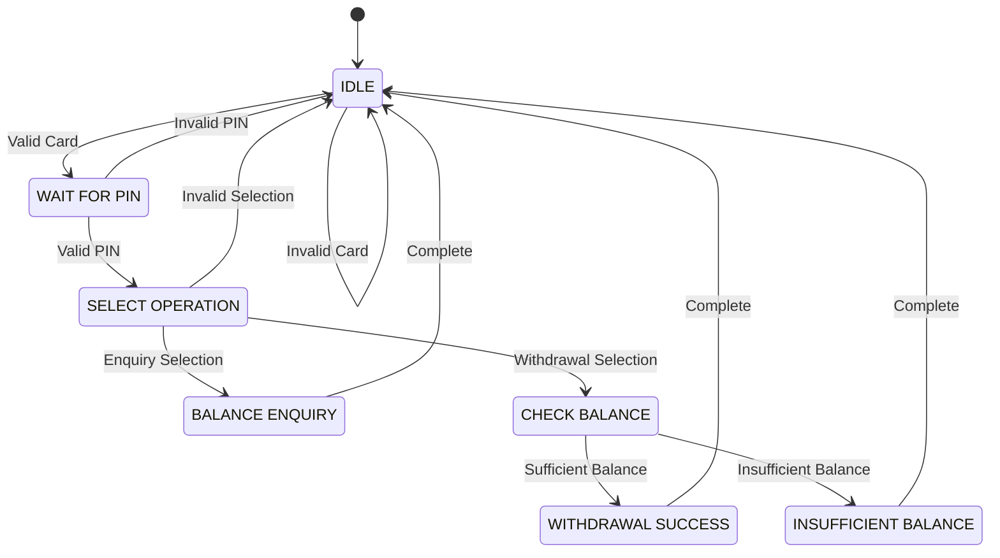

# 🏧 SMART ATM – FSM-Controlled Automated Banking System on FPGA

<p align="center">
  
  
  
  
</p>

<p align="center">
  <b>An FPGA-based ATM controller designed using Verilog HDL and a 7-state Finite State Machine.</b>
</p>

---

## 📌 Table of Contents

- [Overview](#-overview)
- [Problem Statement](#-problem-statement)
- [Key Features](#-key-features)
- [FSM Architecture](#-fsm-architecture)
- [FSM State Encoding](#-fsm-state-encoding)
- [Inputs and Outputs](#-inputs-and-outputs)
- [Working Principle](#-working-principle)
- [Hardware and Software](#-hardware-and-software)
- [Simulation and Implementation](#-simulation-and-implementation)
- [Resource Utilization](#-resource-utilization)
- [Project Structure](#-project-structure)
- [Future Improvements](#-future-improvements)
- [Team Members](#-team-members)

---

## 🚀 Overview

This project implements an **ATM Controller using Verilog HDL** and a **Finite State Machine (FSM)** on an FPGA platform.

The controller performs card validation, PIN verification, balance enquiry, and cash withdrawal. It uses a 7-state FSM to manage transaction sequences and ensure proper control of ATM operations.

## 🎯 Problem Statement

To design and implement an ATM controller using Verilog HDL and a Finite State Machine (FSM) that handles card validation, PIN verification, balance enquiry, and cash withdrawal with proper transaction control.

## ✨ Key Features

- 💳 Card number validation
- 🔐 PIN verification
- 💰 Balance enquiry
- 🏧 Cash withdrawal operation
- ⚖️ Available balance checking
- ❌ Insufficient balance detection
- ✅ Transaction success indication
- 🔄 7-state FSM-based control

---

## ⚙️ FSM Architecture

The ATM controller uses a **Moore-style FSM** with seven states to control the transaction process.

### FSM State Diagram



## 🔢 FSM State Encoding

| FSM State | Encoding | Function |
|---|:---:|---|
| S0 – IDLE | `000` | Waits for card |
| S1 – WAIT_PIN | `001` | Checks PIN |
| S2 – SELECT_OPERATION | `010` | Selects operation |
| S3 – BALANCE_ENQUIRY | `011` | Displays balance |
| S4 – CHECK_BALANCE | `100` | Checks balance |
| S5 – INSUFFICIENT_BALANCE | `101` | Indicates insufficient funds |
| S6 – WITHDRAWAL_SUCCESS | `110` | Confirms successful withdrawal |

---

## 🔌 Inputs and Outputs

### Inputs

| Signal | Description |
|---|---|
| `clk` | System clock |
| `reset` | Resets the FSM |
| `valid` | Operation selection control |
| `branch` | Selects enquiry or withdrawal |
| `CARD_NO[3:0]` | 4-bit card number |
| `P_IN[3:0]` | 4-bit PIN |
| `Amount[3:0]` | Withdrawal amount |

### Outputs

| Signal | Description |
|---|---|
| `state_led[2:0]` | Displays current FSM state |
| `transaction_success` | Indicates successful withdrawal |
| `validity_card` | Card validation status |
| `validity_pin` | PIN validation status |
| `Balance_avail` | Indicates sufficient balance |
| `balance_out[3:0]` | Displays available balance |

---

## 🔄 Working Principle

1. **Idle State:** The controller waits for a card.
2. **Card Validation:** The entered card number is checked.
3. **PIN Verification:** The entered PIN is validated.
4. **Operation Selection:** The user selects balance enquiry or withdrawal.
5. **Balance Enquiry:** The available balance is displayed.
6. **Withdrawal Check:** The requested amount is compared with the available balance.
7. **Transaction Result:** The controller indicates either successful withdrawal or insufficient balance.

---

## 🛠️ Hardware and Software

| Category | Component |
|---|---|
| HDL | Verilog |
| EDA Tool | Xilinx Vivado |
| FPGA Board | Real Digital Boolean |
| FPGA Device | AMD Xilinx Spartan-7 (XC7S50) |
| Design Method | Finite State Machine |
| Implementation | FPGA Synthesis and Implementation |

---

## 🧪 Simulation and Implementation

The project was verified using Xilinx Vivado through:

- RTL design development
- Functional simulation
- Waveform verification
- RTL schematic analysis
- Logic synthesis
- FPGA implementation
- Resource utilization analysis
- Power analysis

<details>
<summary><b>📈 View Simulation and Design Results</b></summary>

Add your project screenshots below:

**1. RTL Schematic**

``

**2. Simulation Waveform**

``

**3. FPGA Implementation**

``

**4. Resource Utilization**

``

**5. Power Report**

``

</details>

## 📊 Resource Utilization

| Resource | Utilization |
|---|---:|
| LUT | 1% |
| Flip-Flops | 1% |
| I/O | 13% |
| BUFG | 3% |

**Reported On-Chip Power:** 4.77 W

<sub>Values are based on the Vivado implementation and power reports.</sub>

---

## 📁 Project Structure

```text
ATM_FSM/
│
├── Design/
│   └── ATM_FSM.v
│
├── Simulation/
│   └── ATM_FSM_tb.v
│
├── README.md
│
└── images/
    ├── rtl_schematic.png
    ├── simulation_waveform.png
    ├── fpga_implementation.png
    ├── resource_utilization.png
    └── power_report.png
```

*Adjust the folder structure to match your actual repository.*

## 🚀 Future Improvements

- Integration of an LCD display for transaction details.
- Addition of keypad-based card and PIN entry.
- Integration of a physical cash dispensing mechanism.
- Support for multiple user accounts.
- Improved security and authentication features.

---

## 👨‍💻 Team Members

| Name | Role |
|---|---|
| HARIHARAN V T | Project Developer |
| MOHAMED SAFI M | Project Developer |

**Mentor:** Mr. Elango Sekar  
Associate Professor, Department of ECE

**Institution:** Bannari Amman Institute of Technology

---

## 🔗 Repository

[View ATM FSM Project on GitHub](https://github.com/hariharan-v-t/ATM_FSM)

---

<p align="center">
  <b>Designed with Verilog HDL | Simulated and Implemented using Xilinx Vivado</b>
  <br>
  ⭐ If you find this project useful, consider giving the repository a star!
</p>